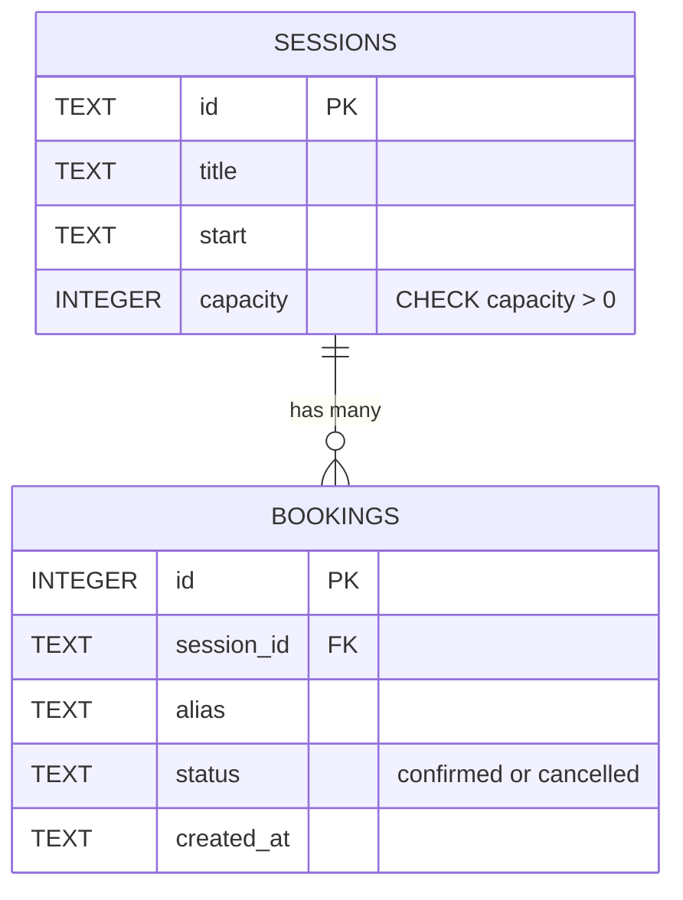

# StudySwap: Entity Diagram

## Tables and relationship

One session can have many bookings. Each booking belongs to exactly one session (one-to-many).

## Where and how capacity is enforced

1. **Database trigger `trg_capacity`**: before every confirmed INSERT, the database counts the confirmed bookings of that session. If the count is equal to or greater than the capacity, the insert is aborted with `session_full`. The check and the insert happen inside one statement, so there is no gap between "count" and "insert". SQLite allows only one writer at a time, so two simultaneous requests cannot both take the last place.
2. **Partial unique index `uq_active_booking`**: one alias can hold only one confirmed booking per session (the double-booking rule).
3. **Foreign key** (`PRAGMA foreign_keys = ON`): a booking for a session that does not exist is rejected by the database and never stored.
4. **Cancel** sets `status = 'cancelled'` (the row is not deleted). Only `confirmed` rows are counted, so a cancelled booking returns its place to the pool.